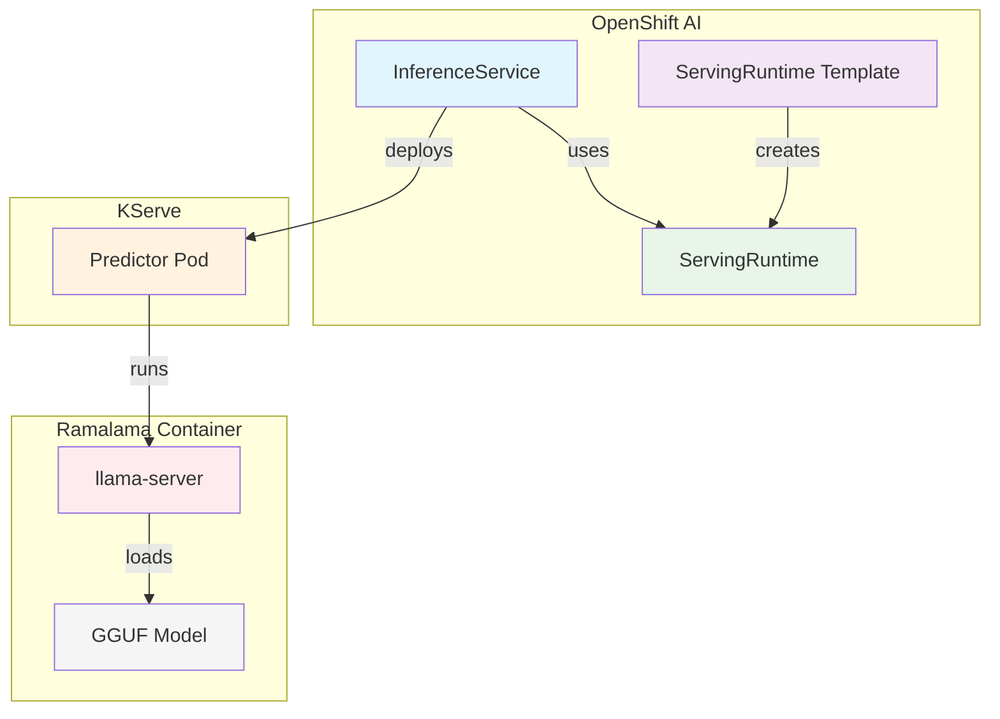

# 🤖 Ramalama OpenShift AI Integration

[](https://www.redhat.com/en/technologies/cloud-computing/openshift/openshift-ai)
[](https://kserve.github.io/website/)
[](https://github.com/containers/ramalama)

> **Run GGUF models on CPU in OpenShift AI using Ramalama/llama.cpp!**

This integration provides ServingRuntime templates that enable Ramalama-based CPU inference in Red Hat OpenShift AI. Three runtime types are available:

| Runtime | Use Case | API Endpoints |
|---------|----------|---------------|
| **Generative** | Chat/Text completion | `/v1/chat/completions`, `/v1/completions` |
| **Embeddings** | Text embeddings | `/v1/embeddings` |
| **Reranking** | Document reranking | `/v1/rerank`, `/rerank` |

It's perfect for:

- **Cost-effective inference** without GPU requirements
- **Edge deployments** where GPUs aren't available
- **Development/testing** environments
- **Smaller models** that run efficiently on CPU

## 📋 Prerequisites

- Red Hat OpenShift AI (RHOAI) installed and configured
- KServe enabled in your OpenShift AI instance
- `oc` CLI configured with cluster access

## 🚀 Quick Start

### Option 1: Using the Template (Recommended)

```bash
# 1. Install the ServingRuntime template in OpenShift AI
oc apply -f k8s/openshift-ai/templates/ramalama-cpu-servingruntime.yaml -n redhat-ods-applications

# 2. Create a new ServingRuntime from the template via OpenShift AI Dashboard
#    OR process the template directly:
oc process ramalama-cpu -n redhat-ods-applications | oc apply -f - -n <your-data-science-project>

# 3. Deploy an InferenceService using the runtime
oc apply -f k8s/openshift-ai/examples/inferenceservice-qwen3-1b.yaml -n <your-data-science-project>
```

### Option 2: Direct ServingRuntime Deployment

```bash
# Deploy the ServingRuntime directly to your data science project
oc apply -f k8s/openshift-ai/base/servingruntime.yaml -n <your-data-science-project>

# Then deploy your InferenceService
oc apply -f k8s/openshift-ai/examples/inferenceservice-qwen3-1b.yaml -n <your-data-science-project>
```

### Option 3: Cluster-Wide ClusterServingRuntime

```bash
# Deploy cluster-wide (requires cluster-admin)
oc apply -f k8s/openshift-ai/base/clusterservingruntime.yaml

# Now any data science project can use 'ramalama-cpu-cluster-runtime'
```

## 🔤 Embeddings Runtime

Deploy text embedding models for RAG pipelines, semantic search, and similarity matching.

```bash
# Install the embeddings template
oc apply -f k8s/openshift-ai/templates/ramalama-embeddings-servingruntime.yaml -n redhat-ods-applications

# Or deploy directly
oc apply -f k8s/openshift-ai/base/servingruntime-embeddings.yaml -n <your-project>

# Deploy an embedding model
oc apply -f k8s/openshift-ai/examples/inferenceservice-embeddings.yaml -n <your-project>
```

### Embeddings API Usage

The example uses [all-MiniLM-L6-v2](https://huggingface.co/second-state/All-MiniLM-L6-v2-Embedding-GGUF), a fast 384-dimensional embedding model.

```bash
# Get embeddings for text
ENDPOINT=$(oc get inferenceservice all-minilm-l6-v2-embeddings -o jsonpath='{.status.url}')

curl ${ENDPOINT}/v1/embeddings \
  -H "Content-Type: application/json" \
  -d '{
    "input": "What is machine learning?",
    "model": "all-minilm-l6-v2-embeddings"
  }'

# Batch embeddings
curl ${ENDPOINT}/v1/embeddings \
  -H "Content-Type: application/json" \
  -d '{
    "input": ["First sentence", "Second sentence", "Third sentence"],
    "model": "all-minilm-l6-v2-embeddings"
  }'
```

### Recommended Embedding Models

| Model | Size | Dimensions | Use Case |
|-------|------|------------|----------|
| `all-MiniLM-L6-v2` | ~23MB | 384 | General purpose, fast (default) |
| `bge-small-en-v1.5` | ~33MB | 384 | High quality English |
| `nomic-embed-text` | ~137MB | 768 | Longer context support |

## 📊 Reranking Runtime

Deploy reranker models for improving search relevance in RAG systems.

```bash
# Install the reranking template
oc apply -f k8s/openshift-ai/templates/ramalama-rerank-servingruntime.yaml -n redhat-ods-applications

# Or deploy directly
oc apply -f k8s/openshift-ai/base/servingruntime-rerank.yaml -n <your-project>

# Deploy a reranker model
oc apply -f k8s/openshift-ai/examples/inferenceservice-rerank.yaml -n <your-project>
```

### Reranking API Usage

The example uses [MS MARCO MiniLM L12 v2](https://huggingface.co/mradermacher/ms-marco-MiniLM-L12-v2-GGUF), a fast cross-encoder reranker trained on MS MARCO passage ranking.

```bash
# Rerank documents against a query
ENDPOINT=$(oc get inferenceservice ms-marco-reranker -o jsonpath='{.status.url}')

curl ${ENDPOINT}/v1/rerank \
  -H "Content-Type: application/json" \
  -d '{
    "model": "ms-marco-reranker",
    "query": "What is machine learning?",
    "documents": [
      "Machine learning is a subset of artificial intelligence.",
      "The weather today is sunny.",
      "Deep learning uses neural networks with many layers.",
      "I like to eat pizza."
    ],
    "top_n": 2
  }'
```

### Response Format

```json
{
  "model": "ms-marco-reranker",
  "results": [
    {"index": 0, "relevance_score": 0.95},
    {"index": 2, "relevance_score": 0.87}
  ]
}
```

### Recommended Reranker Models

| Model | Size | Use Case |
|-------|------|----------|
| `ms-marco-MiniLM-L12-v2` | ~33MB | Fast, MS MARCO trained (default) |
| `bge-reranker-base` | ~278MB | Good quality |
| `bge-reranker-v2-m3` | ~568MB | Multi-lingual, high quality |

## 📁 Directory Structure

```
k8s/openshift-ai/
├── README.md                                    # This file
├── base/
│   ├── kustomization.yaml                       # Kustomize configuration
│   ├── servingruntime.yaml                      # Generative (chat/completion)
│   ├── servingruntime-embeddings.yaml           # Embeddings runtime
│   ├── servingruntime-rerank.yaml               # Reranking runtime
│   └── clusterservingruntime.yaml               # Cluster-wide generative runtime
├── templates/
│   ├── ramalama-cpu-servingruntime.yaml         # Template: Generative
│   ├── ramalama-cpu-clusterservingruntime.yaml  # Template: Cluster-wide generative
│   ├── ramalama-embeddings-servingruntime.yaml  # Template: Embeddings
│   └── ramalama-rerank-servingruntime.yaml      # Template: Reranking
└── examples/
    ├── inferenceservice-qwen3-1b.yaml           # Generative model example
    ├── inferenceservice-with-pvc.yaml           # PVC storage example
    ├── inferenceservice-s3.yaml                 # S3 storage example
    ├── inferenceservice-embeddings.yaml         # Embeddings example
    └── inferenceservice-rerank.yaml             # Reranking example
```

## 🎛️ Template Parameters

### Generative Runtime (`ramalama-cpu`)

| Parameter | Default | Description |
|-----------|---------|-------------|
| `IMAGE` | `quay.io/ramalama/ramalama:latest` | Container image to use |
| `RUNTIME_VERSION` | `latest` | Version tag for the runtime |
| `CTX_SIZE` | `4096` | Context window size |
| `THREADS` | `-1` | CPU threads (-1 for auto) |
| `TEMPERATURE` | `0.7` | Generation temperature |
| `TOP_K` | `40` | Top-K sampling |
| `TOP_P` | `0.9` | Top-P (nucleus) sampling |
| `MIN_P` | `0` | Min-P sampling |
| `CACHE_REUSE` | `256` | Token cache reuse |
| `CPU_REQUEST` | `2` | CPU request |
| `CPU_LIMIT` | `8` | CPU limit |
| `MEMORY_REQUEST` | `4Gi` | Memory request |
| `MEMORY_LIMIT` | `16Gi` | Memory limit |

### Embeddings Runtime (`ramalama-embeddings`)

| Parameter | Default | Description |
|-----------|---------|-------------|
| `IMAGE` | `quay.io/ramalama/ramalama:latest` | Container image to use |
| `POOLING_TYPE` | `mean` | Pooling type: `mean`, `cls`, `last`, `none` |
| `CTX_SIZE` | `512` | Context window size |
| `THREADS` | `-1` | CPU threads (-1 for auto) |
| `BATCH_SIZE` | `2048` | Logical batch size |
| `UBATCH_SIZE` | `512` | Physical micro-batch size |
| `CPU_REQUEST` | `1` | CPU request |
| `CPU_LIMIT` | `4` | CPU limit |
| `MEMORY_REQUEST` | `1Gi` | Memory request |
| `MEMORY_LIMIT` | `4Gi` | Memory limit |

### Reranking Runtime (`ramalama-rerank`)

| Parameter | Default | Description |
|-----------|---------|-------------|
| `IMAGE` | `quay.io/ramalama/ramalama:latest` | Container image to use |
| `CTX_SIZE` | `512` | Context window size |
| `THREADS` | `-1` | CPU threads (-1 for auto) |
| `BATCH_SIZE` | `2048` | Logical batch size |
| `UBATCH_SIZE` | `512` | Physical micro-batch size |
| `CPU_REQUEST` | `1` | CPU request |
| `CPU_LIMIT` | `4` | CPU limit |
| `MEMORY_REQUEST` | `1Gi` | Memory request |
| `MEMORY_LIMIT` | `4Gi` | Memory limit |

### Example with Custom Parameters

```bash
# Generative model with custom settings
oc process ramalama-cpu -n redhat-ods-applications \
  -p IMAGE=ghcr.io/kush-gupt/qwen3-4b-ramalama:latest \
  -p CTX_SIZE=8192 \
  -p THREADS=16 \
  -p CPU_LIMIT=16 \
  -p MEMORY_LIMIT=32Gi \
  | oc apply -f - -n my-project

# Embeddings with CLS pooling
oc process ramalama-embeddings -n redhat-ods-applications \
  -p POOLING_TYPE=cls \
  -p BATCH_SIZE=4096 \
  | oc apply -f - -n my-project
```

## 🗂️ Model Storage Options

### 1. Modelcar (OCI Container with Embedded Model)

The simplest approach - models are baked into container images:

```yaml
spec:
  predictor:
    model:
      storageUri: oci://ghcr.io/kush-gupt/qwen3-1b-ramalama:latest
```

### 2. PersistentVolumeClaim (PVC)

For models stored on persistent storage:

```yaml
spec:
  predictor:
    model:
      storageUri: pvc://my-model-pvc/path/to/model.gguf
```

### 3. S3-Compatible Object Storage

For models in S3/MinIO/ODF:

```yaml
spec:
  predictor:
    model:
      storageUri: s3://my-bucket/models/my-model.gguf
      storage:
        key: aws-connection-my-data-connection
```

## 🔧 Supported Model Formats

The Ramalama ServingRuntimes support different model formats based on use case:

### Generative Runtime

| Format | Description |
|--------|-------------|
| `gguf` | GGUF quantized models (llama.cpp native) |
| `llama` | LLaMA-compatible models |
| `ramalama` | Ramalama modelcar images |

### Embeddings Runtime

| Format | Description |
|--------|-------------|
| `gguf` | GGUF quantized embedding models |
| `embedding` | Dedicated embedding models |

### Reranking Runtime

| Format | Description |
|--------|-------------|
| `gguf` | GGUF quantized reranker models |
| `reranker` | Dedicated reranker models |

## 📊 API Endpoints

The Ramalama runtimes expose OpenAI-compatible APIs based on the runtime type:

### Generative Runtime

| Endpoint | Description |
|----------|-------------|
| `/v1/models` | List available models |
| `/v1/chat/completions` | Chat completions (streaming supported) |
| `/v1/completions` | Text completions |
| `/health` | Health check endpoint |
| `/metrics` | Prometheus metrics |

### Embeddings Runtime

| Endpoint | Description |
|----------|-------------|
| `/v1/embeddings` | OpenAI-compatible embeddings API |
| `/embeddings` | Non-OpenAI embeddings (supports all poolings) |
| `/v1/models` | List available models |
| `/health` | Health check endpoint |
| `/metrics` | Prometheus metrics |

### Reranking Runtime

| Endpoint | Description |
|----------|-------------|
| `/v1/rerank` | Rerank documents by relevance |
| `/rerank` | Alias for `/v1/rerank` |
| `/v1/reranking` | Alias for `/v1/rerank` |
| `/v1/models` | List available models |
| `/health` | Health check endpoint |
| `/metrics` | Prometheus metrics |

### Example API Usage

```bash
# Get the inference endpoint
ENDPOINT=$(oc get inferenceservice qwen3-1b-ramalama -o jsonpath='{.status.url}')

# List models
curl ${ENDPOINT}/v1/models

# Chat completion
curl ${ENDPOINT}/v1/chat/completions \
  -H "Content-Type: application/json" \
  -d '{
    "model": "qwen3-1b-ramalama",
    "messages": [{"role": "user", "content": "Hello!"}]
  }'
```

## 🏗️ Architecture



## 🔍 Troubleshooting

### Check ServingRuntime Status

```bash
oc get servingruntime -n <namespace>
oc describe servingruntime ramalama-cpu-runtime -n <namespace>
```

### Check InferenceService Status

```bash
oc get inferenceservice -n <namespace>
oc describe inferenceservice <name> -n <namespace>
```

### View Pod Logs

```bash
oc logs -l serving.kserve.io/inferenceservice=<name> -n <namespace> -f
```

### Common Issues

1. **Pod stuck in Pending**: Check resource requests match available cluster resources
2. **Model loading fails**: Verify storageUri is correct and accessible
3. **OOM errors**: Increase memory limits for larger models
4. **Slow inference**: Consider increasing thread count or using smaller quantized models

## 🆚 Comparison with vLLM Runtime

| Feature | Ramalama (CPU) | vLLM (GPU) |
|---------|----------------|------------|
| Hardware | CPU only | NVIDIA GPU |
| Model Format | GGUF | Safetensors, GGUF |
| Memory Usage | Lower (quantized) | Higher |
| Throughput | Lower | Higher |
| Cost | Lower | Higher |
| Use Case | Dev/Edge/Small models | Production/Large models |

## 📚 Additional Resources

- [Ramalama Project](https://github.com/containers/ramalama)
- [llama.cpp Documentation](https://github.com/ggerganov/llama.cpp)
- [KServe Documentation](https://kserve.github.io/website/)
- [OpenShift AI Documentation](https://docs.redhat.com/en/documentation/red_hat_openshift_ai_self-managed/)

## 🤝 Contributing

Contributions welcome! Please see the main [README](../../README.md) for contribution guidelines.

---

**Ready to run CPU inference on OpenShift AI?**

[](./base/servingruntime.yaml)

